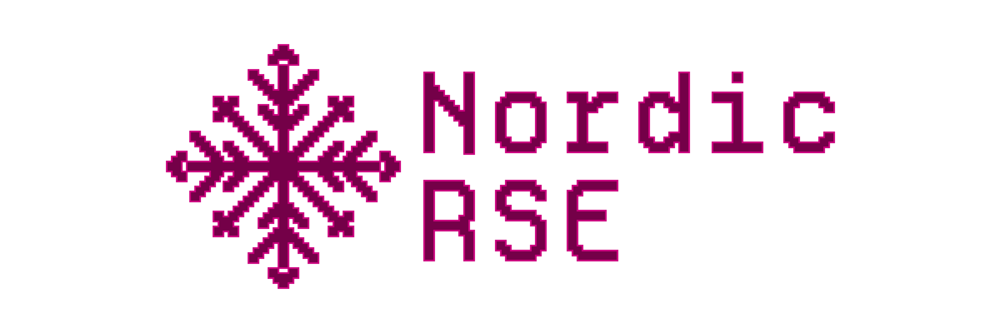

# Nordic-RSE operation manuals



:::{warning}
This page is a work in progress.
:::

These are Nordic-RSE's operation manuals: handbooks, checklists, and templates for how we actually run the association, its board, its conferences, and its website. It's written for people organizing or helping run things — board members, conference organizers, and anyone taking on a task for Nordic-RSE — rather than for the general public.

For that public-facing side — who we are, our events, our blog, how to join — see [nordic-rse.org](https://nordic-rse.org) instead. These manuals are the "how do we actually do this" companion to that site.

These pages document past history, but they don't dictate future.
They are a starting point: feel free to be adventurous.

New here? Start with [onboarding.md](onboarding.md).

```{toctree}
:caption: General
:maxdepth: 1

onboarding
topics
membership
chat
community
meetings
seminar-series
communications
contact
tools-accounts
CONTRIBUTING.md
Logo and artwork <https://github.com/nordic-rse/nordic-rse-materials>

```

```{toctree}
:caption: Conference
:maxdepth: 1

conference/index
conference/roles
conference/timeline
conference/tools-templates
conference/funding
conference/budget
conference/av
conference/session-chair-guide
conference/coc
conference/coc-info-for-organizers

```

```{toctree}
:caption: Board
:maxdepth: 1

board/onboarding
board/annual-meeting
board/annual-meeting-template

```

```{toctree}
:caption: Website
:maxdepth: 1

website/index
website/blog
Planet <https://github.com/nordic-rse/planet>

```

Download this guide as [single-page HTML](https://nordic-rse.github.io/nrse-manuals/_builds/singlehtml/),
[pdf](https://nordic-rse.github.io/nrse-manuals/_builds/nrse-anuals.pdf), or
[epub](https://nordic-rse.github.io/nrse-manuals/_builds/nrse-manuals.epub).

All material within this repository is licensed [CC-BY](LICENSE.md).
